# OniriFix

Corrector editorial **offline**, determinista y trazable para obras de ficción.
OniriFix no reescribe la voz del autor: detecta problemas mecánicos (L1),
propone cambios asistidos (L2) y deja los avisos editoriales (L3) para la
decisión humana.

> Estado: **alpha**. La interfaz y el esquema de la base de datos todavía pueden
> cambiar antes de la versión 1.0.

## Interfaz de escritorio

Además de la CLI, OniriFix trae una ventana para revisar el manuscrito con
calma, con el mismo aspecto oscuro de TagFlow. Usa exactamente el mismo motor y
las mismas reglas que la consola.

```bash
pip install -e ".[gui]"     # instala PySide6
onirifix gui                # o: onirifix gui mi-novela.md
onirifix-gui                # lanzador directo, sin consola
```

En Windows, el instalador añade **OniriFix (ventana)** al menú Inicio
(`OniriFix-GUI.exe`).

El recorrido es siempre el mismo:

1. **Abre** un `.md`, `.txt`, `.docx` o `.pdf`. El análisis empieza solo y
   **no toca** el archivo. Una barra muestra la regla en curso («Regla TIL-002 ·
   23 de 39») y **Cancelar (Esc)** lo detiene sin cambiar nada.
2. **Elige reglas y niveles** en el panel izquierdo (L1, L2, L3 o reglas
   sueltas) y vuelve a analizar con `F5`.
3. **Revisa** en la tabla. Filtra por nivel, regla, capítulo, estado o texto.
   El inspector muestra el contexto **antes** y **después** del cambio.
4. **Decide**: los L1 llegan aceptados, los L2 pendientes y los L3 son solo
   avisos de lectura (no se pueden aplicar). Acepta o rechaza uno a uno
   (teclas `A` y `R` en la tabla), con las casillas, o en bloque con
   **Aceptar visibles** / **Rechazar visibles**, **Aceptar regla** (todos los
   pendientes de la regla activa, `Ctrl+Shift+A`) y **Aceptar L2 seguras**
   (`Ctrl+L`, las L2 de la lista `l2_seguras` que llegan a su umbral).
5. **Mira el hallazgo en su sitio**: doble clic o `Ctrl+T` abre la pestaña
   **Texto completo** con el fragmento resaltado; el selector **Ir a** salta
   al inicio de cada capítulo.
6. **Aplica los cambios**. Antes de escribir se guarda una copia con marca de
   tiempo y cada cambio queda en la auditoría. Un `.docx` o `.pdf` nunca se
   reescribe: el texto corregido va a un `.corregido.md` al lado. Después se
   vuelve a analizar el texto corregido.
7. **Exporta el informe** (Markdown, CSV, JSON, **PDF** y el diff de lo
   aplicado). Si hubo cambios, también sale el **manuscrito corregido en PDF**.

Atajos: `Ctrl+O` abrir, `F5` analizar, `Ctrl+F` buscar, `Ctrl+Shift+F` limpiar
filtros, `Ctrl+T` hallazgos/texto, `Ctrl+S` aplicar, `Ctrl+E` exportar, `Esc`
cancelar el análisis. La ventana recuerda el último manuscrito, los filtros y
las secciones plegadas.

Mientras analiza, aplica o exporta, una capa de espera bloquea el resto de
acciones para que nada se pise. Las secciones laterales se pliegan y la ventana
recuerda su tamaño y el último manuscrito.

### Análisis y revisión

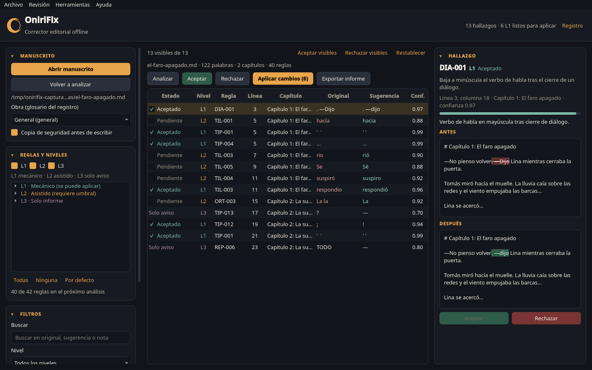

### Filtros por nivel, regla y capítulo

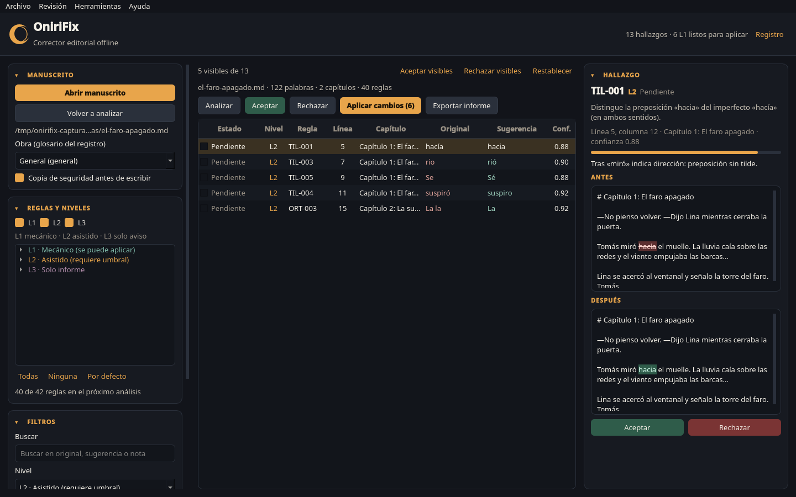

### Inspector y estadísticas

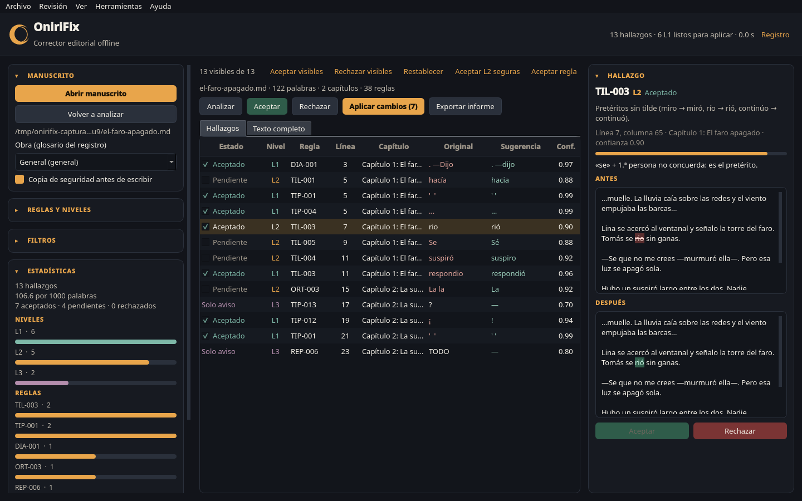

### Después de aplicar

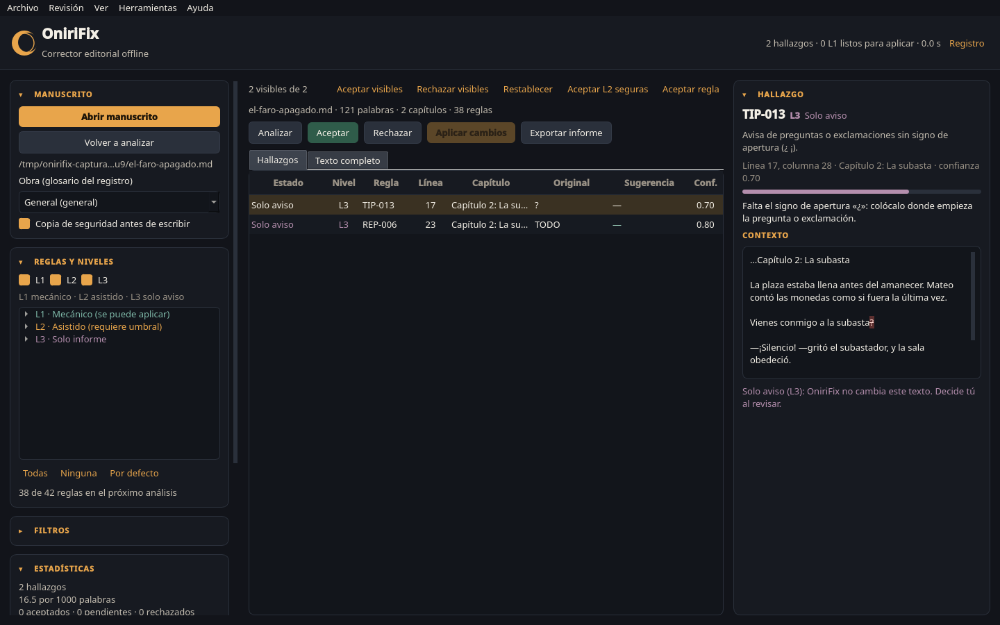

El resto (inicio, capa de espera, inspector) está en
[`docs/screenshots/`](docs/screenshots/). Las capturas salen de la ventana real
con un relato inventado: `python scripts/capture_gui_screenshots.py`.

## Prueba de fuego: un manuscrito real

Antes de publicar la interfaz, OniriFix se probó con el primer libro completo
de una novela en curso: un PDF de 741 páginas, unas 223 000 palabras, 21
capítulos y un epílogo. El manuscrito no está en el repositorio; estas
capturas son de la ventana real trabajando sobre él
(`scripts/capturar_prueba_fuego.py --manuscrito …`).

| Paso | Antes | Después |
|---|---|---|
| Análisis completo (CLI) | 138,7 s | **3,7–3,9 s** (1,9 s de extracción del PDF) |
| Bloqueo máximo de la interfaz durante el análisis | — (2 min con spinner) | **≤ 75 ms** |
| Filtrar 2 500 hallazgos por nivel o regla | — | 55–75 ms |
| Abrir el texto completo (1,4 MB) y saltar a un hallazgo | — | 96 ms la primera vez, 7 ms cada salto |
| Aplicar 2 358 cambios y volver a analizar | — | 2,3 s |
| Exportar informe y manuscrito en PDF (23 + 865 páginas) | — | 2,5 s |
| Hallazgos (L1 / L2 / L3) | 1 306 / 1 368 / 160 | 1 320 / 1 132 / 64 |

El cuello de botella era `TIL-001`, que buscaba la palabra anterior con una
expresión regular sobre todo el texto previo (coste cuadrático): pasó de 135 s
a 0,03 s. El resto de la bajada de hallazgos es ruido eliminado tras revisar
muestras de cada regla a mano (falsos positivos en diálogo, siglas, pronombres
y adjetivos). Con `corregir --l2-seguras` se aplicaron los 1 320 L1 y 1 038 de
las 1 132 L2; quedan 94 L2 y 64 avisos L3 para el autor, todos listados en el
informe PDF.

### Abrir y analizar

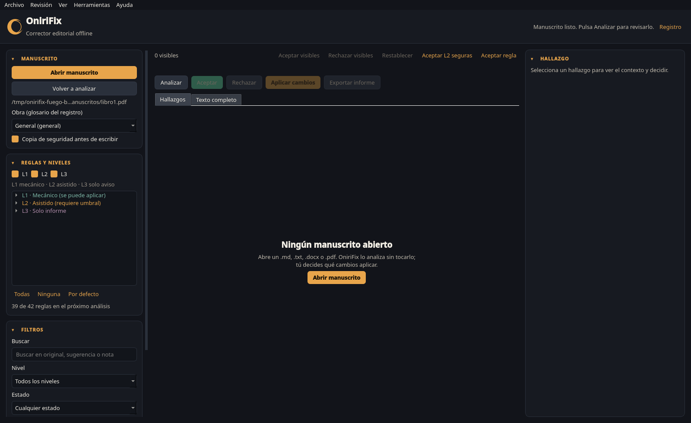

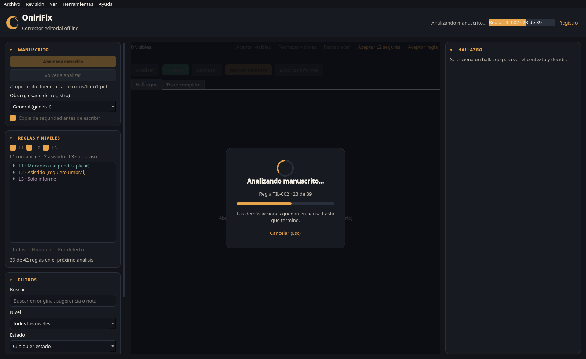

### Revisar un hallazgo y verlo en el texto

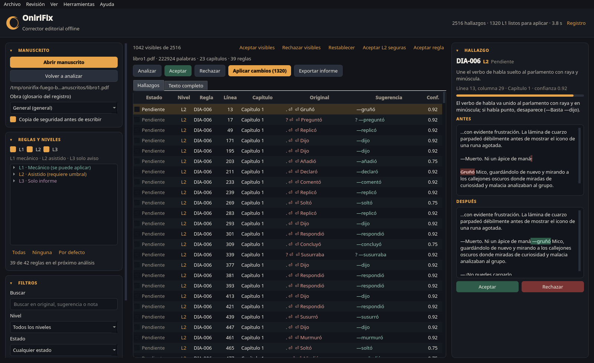

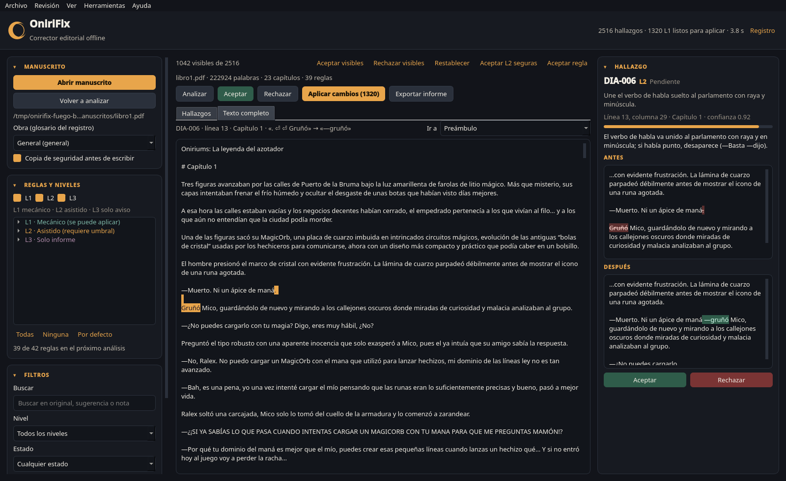

### Estadísticas, L2 seguras y aplicar

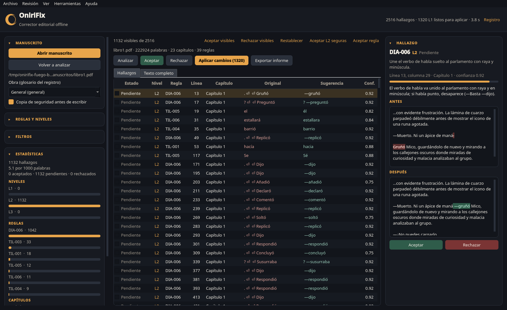

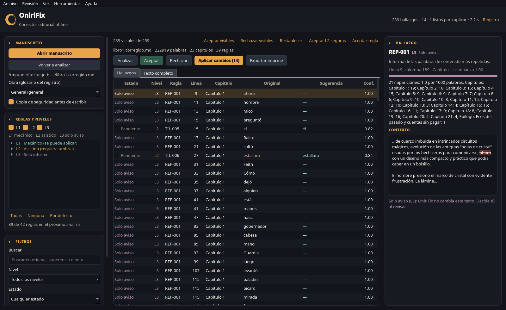

### Informe en PDF

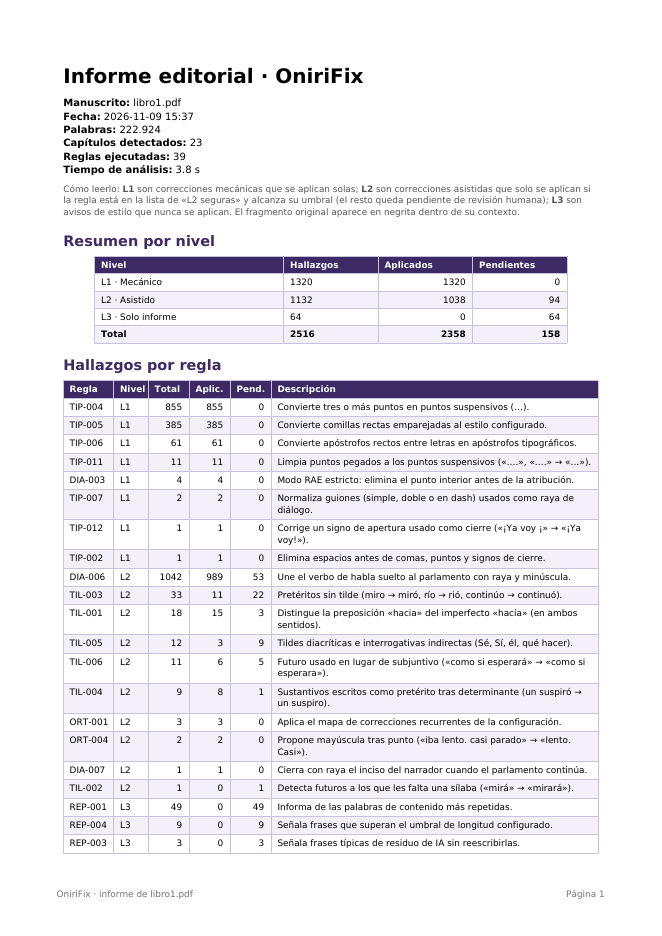

Más capturas del recorrido (18, 22 y 24) en
[`docs/screenshots/`](docs/screenshots/).

## Capturas de la consola

Las imágenes salen del ejecutable empaquetado, ejecutado en consolas reales de
Windows. No son maquetas ni capturas de los tests.

### Primer arranque

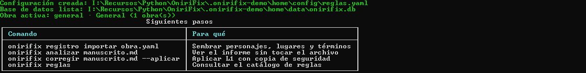

### Diagnóstico del entorno

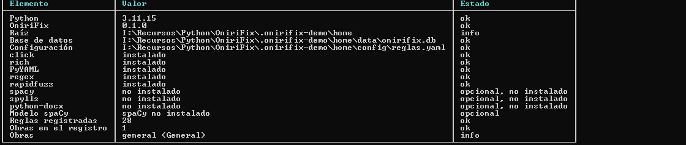

### Análisis sin tocar el manuscrito

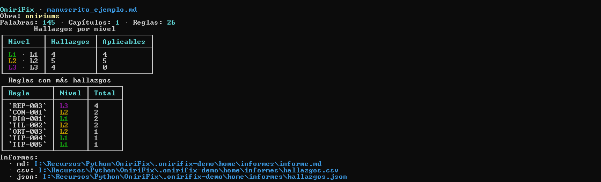

### Corrección aplicada con copia de seguridad

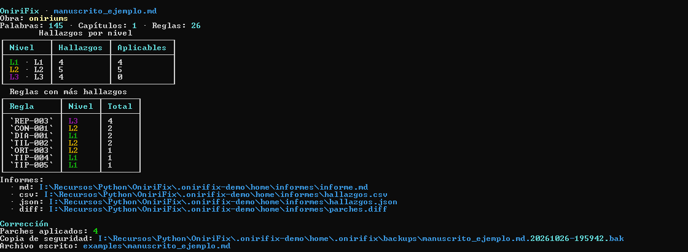

### Catálogo de reglas

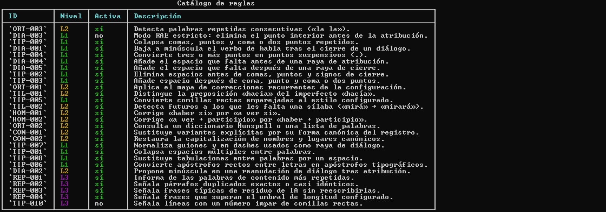

El resto de capturas (ayuda, registro, informes) está en
[`docs/screenshots/`](docs/screenshots/).

## Instalación en Windows

`dist\` contiene tres artefactos equivalentes en código, pero pensados para usos
distintos:

| Artefacto | Para qué sirve |
| :--- | :--- |
| `OniriFix-Setup-0.1.0.exe` | Instalador con asistente, accesos directos y desinstalador. |
| `OniriFix.exe` | CLI portable; no necesita instalación ni Python. |
| `OniriFix-GUI.exe` | Interfaz de escritorio portable, sin consola. |

### Instalador

1. Ejecuta `dist\OniriFix-Setup-0.1.0.exe`.
2. Acepta la licencia y elige la carpeta de instalación.
3. Marca, si quieres, **Añadir OniriFix al PATH del usuario** y **Crear un
   acceso directo en el escritorio**.
4. Al terminar, abre **OniriFix** desde el menú Inicio. Se abre una consola con
   el entorno preparado y los ejemplos copiados a `%USERPROFILE%\OniriFix`.

El instalador no requiere Python ni permisos de administrador: instala en el
perfil del usuario. Como el ejecutable no está firmado, SmartScreen puede pedir
confirmación la primera vez; usa **Más información → Ejecutar de todas formas**
solo si descargaste el archivo de una fuente fiable.

Primeros comandos dentro de la consola instalada:

```bat
onirifix init
onirifix registro importar examples\obra.ejemplo.yaml
onirifix --obra oniriums analizar examples\manuscrito_ejemplo.md
onirifix --obra oniriums corregir examples\manuscrito_ejemplo.md --aplicar
```

Los datos (base SQLite, configuración y copias de seguridad) viven en
`%USERPROFILE%\OniriFix`. El desinstalador elimina el programa y el acceso del
PATH, pero conserva esa carpeta para no borrar trabajo del autor.

Los detalles de compilación, instalación silenciosa y desinstalación están en
[`docs/files/instalacion.md`](docs/files/instalacion.md).

### Ejecutable portable

```bat
dist\OniriFix.exe --help
dist\OniriFix.exe init
```

El portable escribe en el directorio actual salvo que se defina
`ONIRIFIX_HOME`. Es la opción cómoda para probar sin instalar nada.

## Características

- Funciona con cualquier obra: novela, relato, guion o antología.
- Registro SQLite de obras, personajes, lugares, términos, variantes y verbos
  de habla.
- Tres niveles de intervención:
  - **L1**: correcciones mecánicas y seguras (espacios, comillas, rayas…).
  - **L2**: propuestas asistidas con umbral de confianza (tildes, homófonos,
    consistencia onomástica…).
  - **L3**: informes que nunca modifican el archivo (repetición, duplicados,
    frases de residuo de IA…).
- **Dry-run por defecto**: `analizar` y `corregir` no tocan el manuscrito salvo
  que se pida `--aplicar`.
- Copias de seguridad con marca de tiempo antes de escribir.
- Auditoría de cambios en SQLite.
- Lee `.md`, `.txt`, `.docx` y `.pdf` (texto extraíble: Word exportado a PDF,
  por ejemplo). Del PDF reconstruye párrafos y capítulos y quita números de
  página, cabeceras repetidas y guiones de corte de línea.
- Informes Markdown, CSV, JSON, diff y **PDF** (resumen por nivel, regla y
  capítulo, pendientes con contexto y avisos L3), más el **manuscrito
  corregido en PDF**.
- **L2 seguras**: lista configurable de reglas L2 verificadas que se pueden
  aplicar en bloque, cada una con su umbral.
- Interfaz de escritorio opcional (PySide6) para revisar, aceptar o rechazar
  hallazgos y aplicar con copia de seguridad.
- Reglas enchufables y descubrimiento automático.
- Dependencias opcionales para spaCy (POS tagging) y Hunspell (spylls).

## Instalación desde el código fuente

Requiere Python 3.11 o superior.

```bash
python -m venv .venv
# Windows
.venv\Scripts\activate
# macOS / Linux
source .venv/bin/activate

pip install -e .
```

Para desarrollo:

```bash
pip install -e ".[dev]"
```

Dependencias opcionales:

```bash
pip install -e ".[nlp]"        # spaCy (requiere descargar un modelo)
pip install -e ".[ortografia]" # spylls + diccionario Hunspell
pip install -e ".[docx]"       # lectura de .docx
pip install -e ".[pdf]"        # leer PDF sin poppler y exportar a PDF (pdfminer.six, reportlab)
pip install -e ".[gui]"        # interfaz de escritorio (PySide6, incluye [pdf])
```

Para leer PDF, OniriFix usa `pdftotext` (poppler) si está en el `PATH`, que es
unas ocho veces más rápido, y si no `pdfminer.six`. El PDF tiene que tener
texto: un escaneo sin OCR no sirve.

## Manuscrito en PDF

```bash
# Analizar el PDF tal cual (no se modifica).
onirifix analizar libro.pdf --formato md,csv,json,pdf

# Aplicar L1 + las L2 seguras y exportar el informe y el manuscrito en PDF.
# El texto corregido se escribe en libro.corregido.md; el PDF original no se toca.
onirifix corregir libro.pdf --l2-seguras --aplicar --formato md,csv,json,diff,pdf
```

Salen `informe.pdf` (resumen por nivel, regla y capítulo, pendientes con su
contexto, avisos L3 y una muestra de lo aplicado) y `manuscrito-corregido.pdf`
(un capítulo por página).

## Inicio rápido

```bash
# 1. Crear la base de datos, la configuración y la obra activa.
onirifix init

# 2. Importar una obra de ejemplo (personajes, lugares, términos…).
onirifix registro importar examples/obra.ejemplo.yaml

# 3. Analizar sin modificar nada.
onirifix --obra oniriums analizar examples/manuscrito_ejemplo.md

# 4. Ver la corrección que se aplicaría.
onirifix --obra oniriums corregir examples/manuscrito_ejemplo.md

# 5. Aplicar solo L1, con copia de seguridad.
onirifix --obra oniriums corregir examples/manuscrito_ejemplo.md --aplicar
```

También se puede usar `python -m onirifix` si no se quiere instalar el
entrypoint.

## La obra activa

Cada comando puede trabajar sobre una obra distinta con `--obra` (o `-o`):

```bash
onirifix --obra oniriums analizar manuscrito.md
onirifix --obra mi-novela registro personajes listar
```

La obra se guarda en el registro SQLite. La obra `general` se crea
automáticamente la primera vez que se usa.

## Niveles y seguridad

| Nivel | Qué hace | Se aplica con |
| :--- | :--- | :--- |
| L1 | Correcciones mecánicas de alta confianza | `--aplicar` (por defecto) |
| L2 | Propuestas que requieren contexto | `--aplicar-l2 --umbral 0.9`, o solo las verificadas con `--l2-seguras` |
| L3 | Solo informe | Nunca |

`corregir` es dry-run por defecto. Para escribir hay que añadir `--aplicar`.
Los cambios L2 requieren, además, `--aplicar-l2` y respetar el umbral, o
`--l2-seguras`, que aplica solo las reglas de la lista `l2_seguras` de la
configuración (cada una con su umbral, por ejemplo `DIA-006: 0.92`). Esa lista
sale de revisar a mano muestras de un manuscrito real; lo demás queda pendiente
en el informe.

## Comandos principales

```bash
onirifix init
onirifix analizar ARCHIVO [--salida DIR] [--formato md,csv,json] [--estricto]
onirifix corregir ARCHIVO [--aplicar] [--aplicar-l2] [--umbral 0.9] [--l2-seguras]
onirifix revisar ARCHIVO
onirifix frecuencia ARCHIVO
onirifix duplicados ARCHIVO
onirifix reglas
onirifix doctor
onirifix gui [ARCHIVO]

onirifix registro obras listar
onirifix registro obras crear "Mi novela" --autor "Autora"
onirifix registro personajes agregar "Feith Noir" --alias Feith
onirifix registro lugares agregar "Villa Gris" --tipo ciudad
onirifix registro terminos agregar Oniriums --sensible
onirifix registro terminos variante Oniriums Onirium
onirifix registro verbos agregar trinó
onirifix registro importar examples/obra.ejemplo.yaml
onirifix registro exportar mi-obra.yaml
onirifix registro historial
```

Usa `onirifix --help` o `onirifix COMANDO --help` para ver todas las opciones.

## Configuración

La configuración vive en `config/reglas.yaml`. Los valores ausentes se toman de
los defaults internos. La precedencia es:

```text
defaults internos < config/reglas.yaml < variables de entorno < opciones CLI
```

Variables de entorno más útiles:

| Variable | Efecto |
| :--- | :--- |
| `ONIRIFIX_HOME` | Raíz del proyecto (por defecto, el directorio actual). |
| `ONIRIFIX_DB` | Ruta de la base SQLite. |
| `ONIRIFIX_CONFIG` | Ruta del YAML de reglas. |
| `ONIRIFIX_SALIDA` | Directorio de informes. |
| `ONIRIFIX_BACKUPS` | Directorio de copias de seguridad. |
| `ONIRIFIX_OBRA` | Slug de la obra activa. |
| `ONIRIFIX_UMBRAL_L2` | Umbral por defecto para L2. |
| `ONIRIFIX_BACKUP` | `true`/`false`: copia antes de escribir. |
| `ONIRIFIX_AUDITORIA` | `true`/`false`: registra cambios en SQLite. |
| `ONIRIFIX_LOG_LEVEL` | `DEBUG`, `INFO`, `WARNING`… |

El archivo `.env` del directorio de trabajo se carga automáticamente sin
sobrescribir variables ya definidas en el entorno. Usa `.env.template` como
punto de partida.

## Estructura

```text
src/onirifix/
  cli.py              Interfaz Click
  servicio.py         Orquestación de análisis y corrección
  modelo.py           Dominio: hallazgos, parches, obra, glosario…
  config.py           Defaults, YAML, entorno y Settings
  db/                 SQLite: esquema, conexión, repositorios, importador
  nucleo/             Motor de reglas, registro, parches y backups
  reglas/             Catálogo L1/L2/L3
  informes/           Markdown, CSV, JSON y terminal
  gui/                Interfaz de escritorio PySide6
  io/                 Carga y escritura de manuscritos
config/reglas.yaml    Configuración editable
examples/             Obra y manuscrito de ejemplo
tests/                Pruebas automatizadas
docs/                 Índice, guías y capturas
installer/            Instalador Inno Setup y lanzador de consola
scripts/              Icono, capturas y build de la distribución
OniriFix.spec         Empaquetado PyInstaller
```

## Documentación

- [`docs/README.md`](docs/README.md): índice de la documentación y recorridos
  sugeridos.
- [`docs/files/instalacion.md`](docs/files/instalacion.md): instalador,
  ejecutable portable, compilación y desinstalación.
- [`docs/files/arquitectura.md`](docs/files/arquitectura.md): capas, decisiones
  y flujo de datos.
- [`docs/files/reglas.md`](docs/files/reglas.md): catálogo y criterios de cada
  regla.
- [`docs/files/cobertura-informe.md`](docs/files/cobertura-informe.md): qué
  correcciones del informe editorial automatiza cada regla y cuáles quedan
  para la revisión manual.
- [`docs/files/registro.md`](docs/files/registro.md): modelo del registro SQLite
  e importación/exportación.
- [`docs/files/diseno_cli.md`](docs/files/diseno_cli.md): principios de la CLI,
  estilos y salida.
- [`docs/files/project.md`](docs/files/project.md): especificación original.
- [`CONTRIBUTING.md`](CONTRIBUTING.md): cómo añadir reglas y ejecutar pruebas.

## Desarrollo

```bash
pytest
ruff check src tests scripts
mypy src/onirifix
```

Para generar los artefactos de Windows:

```powershell
# Instala extras de empaquetado, genera el icono, compila el .exe,
# ejecuta las pruebas y construye el instalador.
.\scripts\build_release.ps1
```

El script deja `dist\OniriFix.exe`, `dist\OniriFix-GUI.exe` y
`dist\OniriFix-Setup-0.1.0.exe`. Las capturas de la consola se regeneran
abriendo consolas reales; las de la ventana, con Qt en modo `offscreen`:

```powershell
.\.venv\Scripts\python.exe scripts\capture_screenshots.py
.\.venv\Scripts\python.exe scripts\capture_gui_screenshots.py
```

Las pruebas no requieren spaCy ni Hunspell. Las dependencias opcionales se
prueban con el marcador `lento`. Las de la interfaz (`tests/test_gui.py`) se
ejecutan en modo `offscreen` y se omiten si PySide6 no está instalado.

## Licencia

MIT. Consulta [`LICENSE`](LICENSE).
