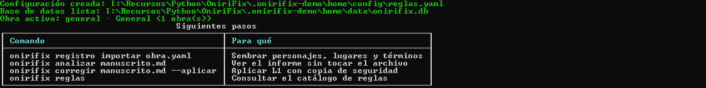
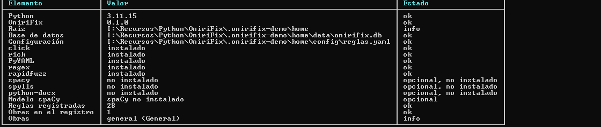
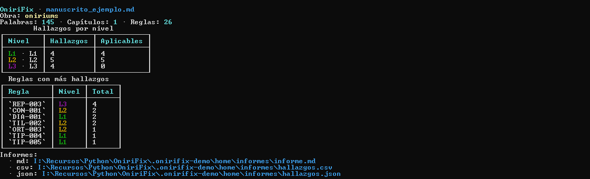
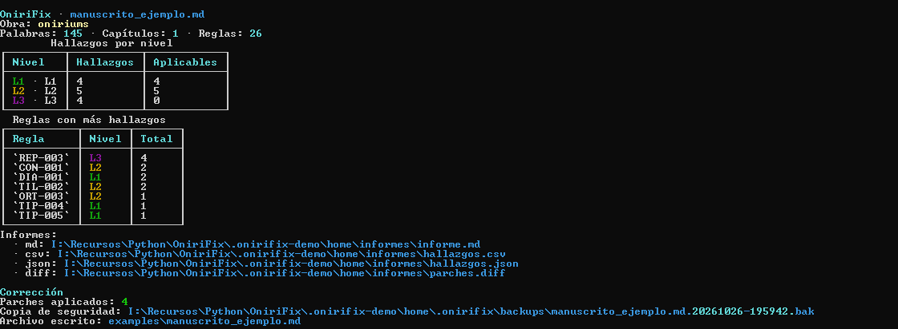
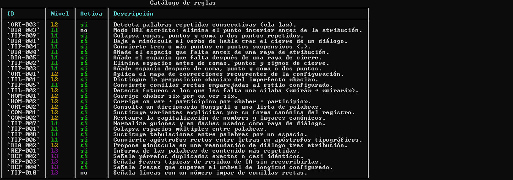

# OniriFix

Corrector editorial **offline**, determinista y trazable para obras de ficción.
OniriFix no reescribe la voz del autor: detecta problemas mecánicos (L1),
propone cambios asistidos (L2) y deja los avisos editoriales (L3) para la
decisión humana.

> Estado: **alpha**. La interfaz y el esquema de la base de datos todavía pueden
> cambiar antes de la versión 1.0.

## Capturas

Las imágenes salen del ejecutable empaquetado, ejecutado en consolas reales de
Windows. No son maquetas ni capturas de los tests.

### Primer arranque



### Diagnóstico del entorno



### Análisis sin tocar el manuscrito



### Corrección aplicada con copia de seguridad



### Catálogo de reglas



El resto de capturas (ayuda, registro, informes) está en
[`docs/screenshots/`](docs/screenshots/).

## Instalación en Windows

`dist\` contiene dos artefactos equivalentes en código, pero pensados para usos
distintos:

| Artefacto | Para qué sirve |
| :--- | :--- |
| `OniriFix-Setup-0.1.0.exe` | Instalador con asistente, accesos directos y desinstalador. |
| `OniriFix.exe` | Ejecutable portable; no necesita instalación ni Python. |

### Instalador

1. Ejecuta `dist\OniriFix-Setup-0.1.0.exe`.
2. Acepta la licencia y elige la carpeta de instalación.
3. Marca, si quieres, **Añadir OniriFix al PATH del usuario** y **Crear un
   acceso directo en el escritorio**.
4. Al terminar, abre **OniriFix** desde el menú Inicio. Se abre una consola con
   el entorno preparado y los ejemplos copiados a `%USERPROFILE%\OniriFix`.

El instalador no requiere Python ni permisos de administrador: instala en el
perfil del usuario. Como el ejecutable no está firmado, SmartScreen puede pedir
confirmación la primera vez; usa **Más información → Ejecutar de todas formas**
solo si descargaste el archivo de una fuente fiable.

Primeros comandos dentro de la consola instalada:

```bat
onirifix init
onirifix registro importar examples\obra.ejemplo.yaml
onirifix --obra oniriums analizar examples\manuscrito_ejemplo.md
onirifix --obra oniriums corregir examples\manuscrito_ejemplo.md --aplicar
```

Los datos (base SQLite, configuración y copias de seguridad) viven en
`%USERPROFILE%\OniriFix`. El desinstalador elimina el programa y el acceso del
PATH, pero conserva esa carpeta para no borrar trabajo del autor.

Los detalles de compilación, instalación silenciosa y desinstalación están en
[`docs/files/instalacion.md`](docs/files/instalacion.md).

### Ejecutable portable

```bat
dist\OniriFix.exe --help
dist\OniriFix.exe init
```

El portable escribe en el directorio actual salvo que se defina
`ONIRIFIX_HOME`. Es la opción cómoda para probar sin instalar nada.

## Características

- Funciona con cualquier obra: novela, relato, guion o antología.
- Registro SQLite de obras, personajes, lugares, términos, variantes y verbos
  de habla.
- Tres niveles de intervención:
  - **L1**: correcciones mecánicas y seguras (espacios, comillas, rayas…).
  - **L2**: propuestas asistidas con umbral de confianza (tildes, homófonos,
    consistencia onomástica…).
  - **L3**: informes que nunca modifican el archivo (repetición, duplicados,
    frases de residuo de IA…).
- **Dry-run por defecto**: `analizar` y `corregir` no tocan el manuscrito salvo
  que se pida `--aplicar`.
- Copias de seguridad con marca de tiempo antes de escribir.
- Auditoría de cambios en SQLite.
- Informes Markdown, CSV, JSON y diff.
- Reglas enchufables y descubrimiento automático.
- Dependencias opcionales para spaCy (POS tagging) y Hunspell (spylls).

## Instalación desde el código fuente

Requiere Python 3.11 o superior.

```bash
python -m venv .venv
# Windows
.venv\Scripts\activate
# macOS / Linux
source .venv/bin/activate

pip install -e .
```

Para desarrollo:

```bash
pip install -e ".[dev]"
```

Dependencias opcionales:

```bash
pip install -e ".[nlp]"        # spaCy (requiere descargar un modelo)
pip install -e ".[ortografia]" # spylls + diccionario Hunspell
pip install -e ".[docx]"       # lectura de .docx
```

## Inicio rápido

```bash
# 1. Crear la base de datos, la configuración y la obra activa.
onirifix init

# 2. Importar una obra de ejemplo (personajes, lugares, términos…).
onirifix registro importar examples/obra.ejemplo.yaml

# 3. Analizar sin modificar nada.
onirifix --obra oniriums analizar examples/manuscrito_ejemplo.md

# 4. Ver la corrección que se aplicaría.
onirifix --obra oniriums corregir examples/manuscrito_ejemplo.md

# 5. Aplicar solo L1, con copia de seguridad.
onirifix --obra oniriums corregir examples/manuscrito_ejemplo.md --aplicar
```

También se puede usar `python -m onirifix` si no se quiere instalar el
entrypoint.

## La obra activa

Cada comando puede trabajar sobre una obra distinta con `--obra` (o `-o`):

```bash
onirifix --obra oniriums analizar manuscrito.md
onirifix --obra mi-novela registro personajes listar
```

La obra se guarda en el registro SQLite. La obra `general` se crea
automáticamente la primera vez que se usa.

## Niveles y seguridad

| Nivel | Qué hace | Se aplica con |
| :--- | :--- | :--- |
| L1 | Correcciones mecánicas de alta confianza | `--aplicar` (por defecto) |
| L2 | Propuestas que requieren contexto | `--aplicar-l2 --umbral 0.9` |
| L3 | Solo informe | Nunca |

`corregir` es dry-run por defecto. Para escribir hay que añadir `--aplicar`.
Los cambios L2 requieren, además, `--aplicar-l2` y respetar el umbral.

## Comandos principales

```bash
onirifix init
onirifix analizar ARCHIVO [--salida DIR] [--formato md,csv,json] [--estricto]
onirifix corregir ARCHIVO [--aplicar] [--aplicar-l2] [--umbral 0.9]
onirifix revisar ARCHIVO
onirifix frecuencia ARCHIVO
onirifix duplicados ARCHIVO
onirifix reglas
onirifix doctor

onirifix registro obras listar
onirifix registro obras crear "Mi novela" --autor "Autora"
onirifix registro personajes agregar "Feith Noir" --alias Feith
onirifix registro lugares agregar "Villa Gris" --tipo ciudad
onirifix registro terminos agregar Oniriums --sensible
onirifix registro terminos variante Oniriums Onirium
onirifix registro verbos agregar trinó
onirifix registro importar examples/obra.ejemplo.yaml
onirifix registro exportar mi-obra.yaml
onirifix registro historial
```

Usa `onirifix --help` o `onirifix COMANDO --help` para ver todas las opciones.

## Configuración

La configuración vive en `config/reglas.yaml`. Los valores ausentes se toman de
los defaults internos. La precedencia es:

```text
defaults internos < config/reglas.yaml < variables de entorno < opciones CLI
```

Variables de entorno más útiles:

| Variable | Efecto |
| :--- | :--- |
| `ONIRIFIX_HOME` | Raíz del proyecto (por defecto, el directorio actual). |
| `ONIRIFIX_DB` | Ruta de la base SQLite. |
| `ONIRIFIX_CONFIG` | Ruta del YAML de reglas. |
| `ONIRIFIX_SALIDA` | Directorio de informes. |
| `ONIRIFIX_BACKUPS` | Directorio de copias de seguridad. |
| `ONIRIFIX_OBRA` | Slug de la obra activa. |
| `ONIRIFIX_UMBRAL_L2` | Umbral por defecto para L2. |
| `ONIRIFIX_BACKUP` | `true`/`false`: copia antes de escribir. |
| `ONIRIFIX_AUDITORIA` | `true`/`false`: registra cambios en SQLite. |
| `ONIRIFIX_LOG_LEVEL` | `DEBUG`, `INFO`, `WARNING`… |

El archivo `.env` del directorio de trabajo se carga automáticamente sin
sobrescribir variables ya definidas en el entorno. Usa `.env.template` como
punto de partida.

## Estructura

```text
src/onirifix/
  cli.py              Interfaz Click
  servicio.py         Orquestación de análisis y corrección
  modelo.py           Dominio: hallazgos, parches, obra, glosario…
  config.py           Defaults, YAML, entorno y Settings
  db/                 SQLite: esquema, conexión, repositorios, importador
  nucleo/             Motor de reglas, registro, parches y backups
  reglas/             Catálogo L1/L2/L3
  informes/           Markdown, CSV, JSON y terminal
  io/                 Carga y escritura de manuscritos
config/reglas.yaml    Configuración editable
examples/             Obra y manuscrito de ejemplo
tests/                Pruebas automatizadas
docs/                 Índice, guías y capturas
installer/            Instalador Inno Setup y lanzador de consola
scripts/              Icono, capturas y build de la distribución
OniriFix.spec         Empaquetado PyInstaller
```

## Documentación

- [`docs/README.md`](docs/README.md): índice de la documentación y recorridos
  sugeridos.
- [`docs/files/instalacion.md`](docs/files/instalacion.md): instalador,
  ejecutable portable, compilación y desinstalación.
- [`docs/files/arquitectura.md`](docs/files/arquitectura.md): capas, decisiones
  y flujo de datos.
- [`docs/files/reglas.md`](docs/files/reglas.md): catálogo y criterios de cada
  regla.
- [`docs/files/registro.md`](docs/files/registro.md): modelo del registro SQLite
  e importación/exportación.
- [`docs/files/diseno_cli.md`](docs/files/diseno_cli.md): principios de la CLI,
  estilos y salida.
- [`docs/files/project.md`](docs/files/project.md): especificación original.
- [`CONTRIBUTING.md`](CONTRIBUTING.md): cómo añadir reglas y ejecutar pruebas.

## Desarrollo

```bash
pytest
ruff check src tests scripts
mypy src/onirifix
```

Para generar los artefactos de Windows:

```powershell
# Instala extras de empaquetado, genera el icono, compila el .exe,
# ejecuta las pruebas y construye el instalador.
.\scripts\build_release.ps1
```

El script deja `dist\OniriFix.exe` y `dist\OniriFix-Setup-0.1.0.exe`. Las
capturas de la documentación se regeneran abriendo consolas reales:

```powershell
.\.venv\Scripts\python.exe scripts\capture_screenshots.py
```

Las pruebas no requieren spaCy ni Hunspell. Las dependencias opcionales se
prueban con el marcador `lento`.

## Licencia

MIT. Consulta [`LICENSE`](LICENSE).
